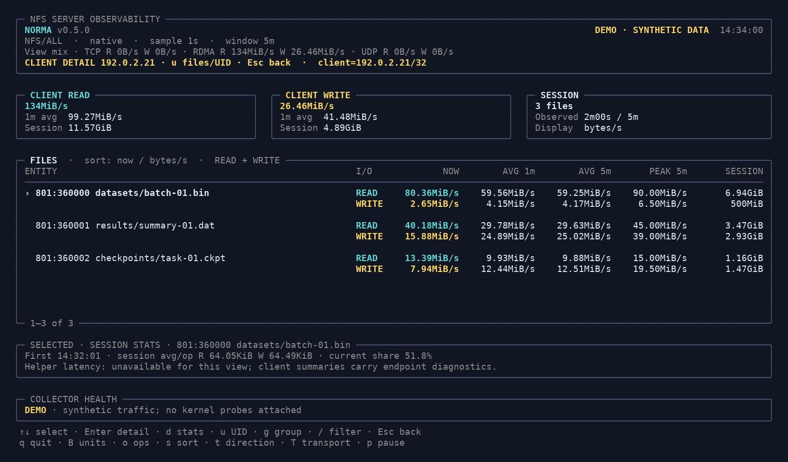
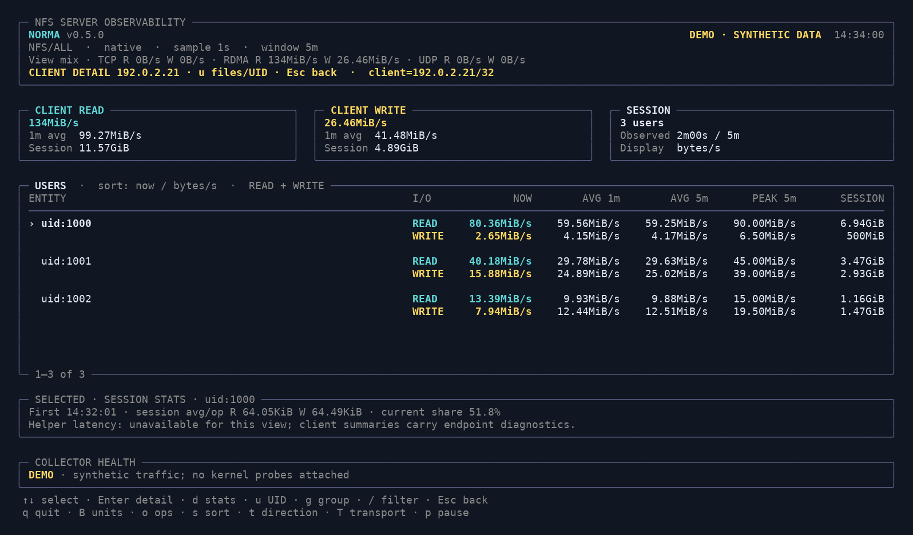
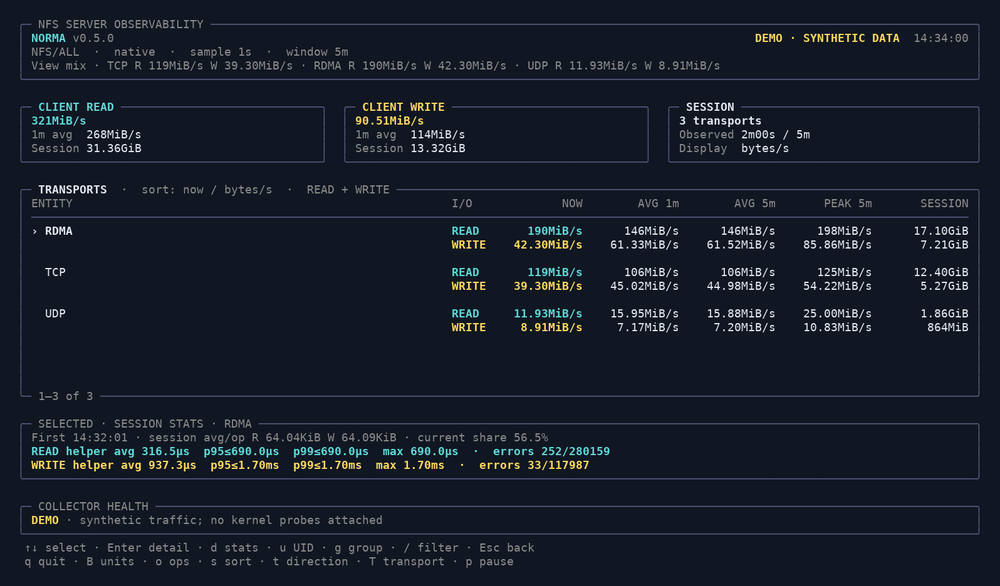
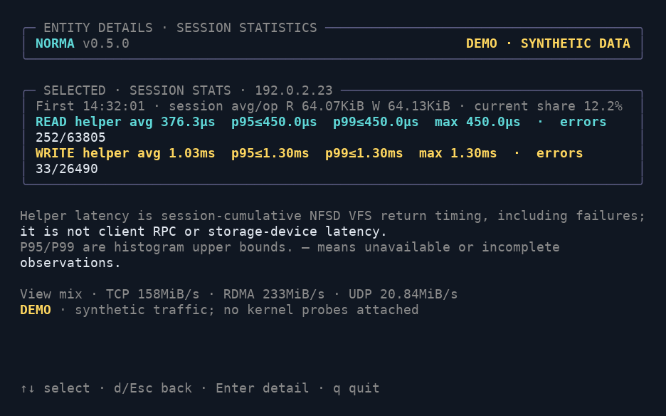

# norma

[English](README.md) | [简体中文](README.zh-CN.md) | [Releases](https://github.com/guixiaocai/norma/releases)

**An iftop-style NFS server I/O monitor for RDMA, TCP and UDP.**

See which clients are reading or writing, compare bursts with rolling averages,
and inspect shared-storage workloads directly from your terminal. The name
comes from **NFS over RDMA**. By default it monitors **all supported NFS
transports** (RDMA, TCP and UDP), so ordinary TCP servers work without extra flags.

`norma` is one executable with two collectors: embedded **native eBPF** by
default, or **bpftrace** selected with `--backend bpftrace`. Both measure
successful NFSD VFS read/write completions for NFSv3/v4 and use the same flags,
display and metric definitions.

## Why use it?

- **RPM deployment and managed upgrades.** Rocky/Alma/RHEL packages support
  package queries, upgrades, downgrades and removal. Tar installs gain a file
  manifest, full-version snapshots, rollback and removal with data retention.
- **Follow an abnormal client without restarting.** Select a client and Enter
  its files/UIDs, switch grouping and filters, compare transport channels, and
  keep session counters. Node aliases retain their IP addresses.
- **Helper latency and failures by client.** Inspect READ/WRITE session mean,
  P95/P99 histogram bounds and maximum NFSD VFS helper duration, plus failures,
  average operation size and load share. Host CPU/disk/network indicators provide
  correlation alongside NFS-specific accounting.
- **A spacious terminal dashboard.** Separate read/write summaries, session
  statistics, a scrollable detail table, collector health and keyboard controls
  make the display easier to scan. The layout adapts to the terminal width.
- **Per-client visibility, including server-cache reads.** Attribute completed
  NFS reads and writes to clients across RDMA, TCP and UDP. Filter by client
  IP/CIDR or server-interface address, and group by client, server, file, UID or GID.
- **Two backends in one command.** Deploy the native collector without a runtime
  bpftrace installation, or explicitly choose bpftrace for an existing tracing
  environment. Compare the deployment tradeoffs below.
- **Kernel adaptation based on capabilities.** Resolve field offsets and
  recognized NFSD signatures from runtime BTF, or supply a reviewed kernel layout
  with `--layout`. A matching layout does not require rebuilding the executable.
- **Rolling statistics with explicit timing.** See current rate, 1-minute and
  configurable-window averages, the highest sample in the window, and session
  totals. Averages include idle time; pausing the display keeps collection running.
- **A terminal tool that also fits scripts.** Automatic unit scaling, byte/bit display and
  terminal restoration sit alongside plain text, JSON Lines and timed collection.
  JSON retains byte and operation metrics independently of display units.

## Quick start

On **Rocky/Alma/RHEL x86_64 NFS servers**, prefer the RPM from the
[release](https://github.com/guixiaocai/norma/releases):

```bash
curl -fLO https://github.com/guixiaocai/norma/releases/download/v0.5.0/norma-0.5.0-1.el8.x86_64.rpm
curl -fLO https://github.com/guixiaocai/norma/releases/download/v0.5.0/SHA256SUMS
sha256sum --ignore-missing -c SHA256SUMS
sudo dnf install ./norma-0.5.0-1.el8.x86_64.rpm
sudo norma --doctor
sudo norma
```

For a tar installation on Linux x86_64, the download installer selects the
latest stable release and verifies its archive against the published SHA256 sum:

```bash
curl -fsSL https://raw.githubusercontent.com/guixiaocai/norma/main/install.sh -o install-norma.sh
sudo bash install-norma.sh
norma --demo                       # preview the dashboard; no root or NFS needed
sudo norma --doctor                # read-only deployment checks
sudo norma                         # native eBPF, all NFS transports, client view
```

**Rocky Linux 8.10 is the primary deployment target.** See the
[deployment and live investigation guide](docs/operations.md) for EL8 layout
preparation, offline installation, RPM/tar lifecycle, configuration and troubleshooting. The
installer installs files; `--doctor` reports prerequisites without loading BPF
or changing the NFS service. Passing these checks is not a live probe test.

For a pinned version, a user-owned prefix or a downloaded release archive:

```bash
sudo bash install-norma.sh --version v0.5.0
bash install-norma.sh --prefix "$HOME/.local"
export PATH="$HOME/.local/bin:$PATH"
# Offline: unpack a verified release archive, enter its directory, then:
sudo ./tools/install.sh
# One-time migration of a pre-manifest v0.4 tar installation:
sudo ./tools/install.sh --adopt-legacy
```

Installing in a user-owned directory needs no root; **live collection still
needs BPF/probe permissions**. Preview with `norma --demo` works unprivileged.
Native collection needs no installed Go, clang, bpftrace or libbpf shared library.

For live collection, the NFS server must already be running. Both backends require
permission to load BPF and attach kprobes/return probes, and compatible NFSD
function signatures and layout metadata. Runtime BTF is tried automatically;
if it cannot describe the required probes, use a reviewed matching layout:

```bash
sudo norma --layout /path/to/layout.json
sudo norma --backend bpftrace --layout /path/to/layout.json
```

See [compatibility](docs/compatibility.md) before deploying on a new kernel.
Changing backend does not repair an unsupported NFSD signature or incorrect
layout. There is **no automatic backend fallback**.

## Choose a backend

| Aspect | Native eBPF (default) | bpftrace (`--backend bpftrace`) |
|---|---|---|
| Shared behavior | NFSv3/v4 completion bytes and operations; RDMA/TCP/UDP filters; all grouping modes; same UI, windows, text and JSON output | Same |
| Deployment | One `norma` executable with embedded BPF objects | Same executable plus installed `bpftrace >= 0.16` and its working runtime dependencies |
| Runtime build tools | No Go compiler, clang or libbpf shared library needed | bpftrace compiles the generated tracing script at startup; its package/runtime must support the probes and features used |
| Collection path | Go attaches probes and reads cumulative BPF maps directly | A supervised bpftrace process emits cumulative text frames that Go parses |
| Startup and overhead | Avoids launching a compiler process and parsing text frames | Adds script compilation, subprocess startup and text-frame processing |
| File view | Device/inode identity plus optional parent/basename hints; hints may be truncated or stale after rename | Device/inode identity, without pathname hints |
| Diagnostics | Reports memory-read, map-capacity and inflight-record problems, failed operations and dropped name hints | Retains bpftrace launch/runtime diagnostics; reports failed operations and overwritten inflight records |
| Practical advantage | Fewer target-host dependencies; convenient for routine monitoring and deployment to many servers | Fits hosts already maintained for bpftrace; compiler and probe diagnostics help investigate that collection path |
| Main tradeoff | Uses the bundled collector and its supported profiles; failures require checking its diagnostics and layout | Depends on the target host's bpftrace installation and adds a child process; switching does not broaden the shared layout contract |

**Start with native** for routine use, especially when you want to copy a release
archive to several servers. Choose bpftrace when your host already has a suitable
bpftrace installation or you specifically want to investigate the bpftrace path.
If one backend fails, inspect the error before selecting the other explicitly.
Neither backend has a measured throughput/CPU advantage established by this
project; the overhead differences above describe their implementation.

Both collectors expose live, non-atomic snapshots and bounded maps. Missing
kernel return probes cannot be reconstructed. bpftrace may coalesce queued
snapshots if the frontend falls behind: cumulative totals are retained, while
peak timing becomes less precise. See [architecture](docs/architecture.md).

## Common commands

```bash
norma --demo                       # synthetic dashboard; no collector attached
norma --demo --no-color            # monochrome preview
sudo norma --doctor                # inspect requirements before collection
sudo norma -p rdma                  # retain the pre-v0.4 RDMA-only behavior
sudo norma -i eno2                 # TCP NFS to eno2's local IP addresses
sudo norma -p rdma -i ib0           # RDMA NFS to ib0's local IP addresses
sudo norma -p all -F 40.0.0.0/16   # all transports, selected client network
sudo norma -w 10m -b               # 1m/10m averages, 10m peak, bit/s
sudo norma -g files                # per-file accounting
sudo norma -g transports           # distinct RDMA/TCP/UDP accounting
sudo norma --config examples/nodes.json -g nodegroups
sudo norma -g files --file-filter dataset
sudo norma --backend bpftrace -g users -p tcp
sudo norma -t -s 120               # plain text for two minutes
sudo norma --json -s 60            # JSON Lines with byte/operation metrics
```

`-i` filters NFS requests by the interface's **local IP addresses**, not physical
packet ingress. It selects TCP when `-p` is omitted. These probes monitor NFS
server I/O; they do not monitor every protocol on the interface.

**Upgrading from v0.3:** the transport default changed from RDMA to `all`.
Set `-p rdma` in existing commands when RDMA-only collection is required.
An explicit `-p` takes precedence over the interface shortcut.

## Display and controls


*All screenshots in this section come from the actual terminal renderer with
synthetic demo data, not production NFS measurements. Expand a view to inspect it.*

<details>
<summary>Client file details — Enter</summary>



Select a client and press Enter to inspect its files; Esc returns to the client list.

</details>

<details>
<summary>Selected-client UID details — u</summary>



Inside a client detail, `u` switches between files and UIDs; Esc returns.

</details>

<details>
<summary>Transport comparison — g / T</summary>



Use `g` to reach transport grouping, `T` to select a transport view, and Enter to expand a transport's clients.

</details>

<details>
<summary>Compact diagnostics at 80 × 24 — d</summary>



Press `d` to open diagnostics for the selected entity on a compact terminal; `d` or Esc returns.

</details>

The dashboard separates connection/context information, read and write rates,
session totals, per-client details, collector health and keyboard controls into
distinct areas. Narrow terminals show a compact selection of columns; widen the
terminal to compare the full rolling statistics; at least 120 columns exposes
every metric column. `--no-color` or a nonempty `NO_COLOR` environment variable
disables color. Text and JSON modes remain available for
logging, automation and terminals where an interactive dashboard is unsuitable.

Each client has READ and WRITE rows: READ is a client reading from this server;
WRITE is a client writing to it.

| Column | Meaning |
|---|---|
| NOW | Rate over the latest sample interval; one second by default (`-r`) |
| AVG 1m | Time-weighted average over the observed last minute, including idle time |
| AVG 5m | Time-weighted average over the configurable window (`-w`, up to 24 hours) |
| PEAK 5m | Highest individual sample rate in that window |
| SESSION / TOTAL | Successfully completed bytes since this monitor started (`SESSION` in the dashboard, `TOTAL` in text output) |

Before a full window has elapsed, averages use only observed time. Peak is a
sample peak, not an instantaneous hardware peak. See [metrics](docs/metrics.md).

| Key | Action |
|---|---|
| `q`, Ctrl+C | Exit and restore the original terminal |
| `B` | Toggle byte/s and bit/s display (`-b` starts in bit/s) |
| `o`, `--ops` | Toggle/show completed operations per second |
| `s` | Cycle sort by current, 1m average, window average, peak, total, name |
| `t` | Both directions, read, write, combined |
| `p` | Freeze the display; collection and rolling windows continue |
| Up/Down, j/k, Page Up/Down | Scroll |
| Enter, Esc | Drill into the selected client/transport, then return |
| `u` | Toggle files/UIDs inside a client detail |
| `g` | Cycle grouping without resetting session attribution |
| `/`, Enter | Apply IP/CIDR or `file=substring` filter; Esc clears/cancels |
| `T` | Cycle all/TCP/RDMA/UDP without detaching probes |
| `d` | Open a selected-entity diagnostics page, including on compact terminals |

Sorting follows the active byte/operation metric and READ/WRITE/combined view.
The selected-entity panel adds session average operation sizes, current rate
share, first observed activity and endpoint helper diagnostics. Percentiles are
histogram upper bounds; helper durations include failed calls and are separate
from rolling throughput windows. Read the [measurement boundaries](docs/operations.md#read-slow-operation-diagnostics-correctly).

Redirection and `-t` produce append-only text without terminal escape sequences.
Optional `-N` name lookup runs asynchronously; addresses are numeric by default.

## Accounting boundary

These are **server logical completion bytes**, including reads satisfied by
the server page cache. They exclude RPC/RDMA headers and are not wire traffic,
physical-disk throughput or proof of reply delivery/durable storage. The host's
own outgoing NFS client access is outside these server probes.

## Build and release

Ordinary builds need Go >= 1.25.3 and make. The repository includes the generated
BPF object, so no clang installation is needed unless you change BPF source.

```bash
make build
./bin/norma --version
make release VERSION=v0.5.0        # tar/zip packages
make rpm VERSION=v0.5.0            # additionally requires rpmbuild
```

`make`/`make build` produce **`bin/norma`**. Both collectors are included in this
static Go executable. Only the bpftrace backend needs a target-host bpftrace
installation.

After changing BPF source, install clang/LLVM, libbpf development headers and gcc,
then regenerate bindings before building:

```bash
# Example on an Ubuntu build machine:
sudo apt-get install clang llvm libbpf-dev gcc make
make generate
make build
```

GitHub Actions builds Linux amd64 RPM/tar/zip packages and SHA256 checksums from a
version tag. See [publishing](docs/publishing.md). Build and CLI checks do not
establish probe correctness on every kernel. NFSD attachment, workload accounting
and cross-kernel runtime validation must be performed on the intended server.

## License and upstream credit

New code: MIT. Native BPF: MIT OR GPL-2.0. bpftrace backend: BSD-2-Clause.
Upstream notices and dependency licenses are retained in [NOTICE](NOTICE) and
`licenses/`. This is a downstream project; see NOTICE for upstream links.
